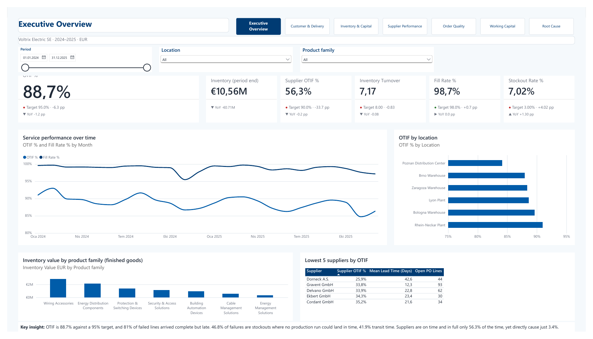
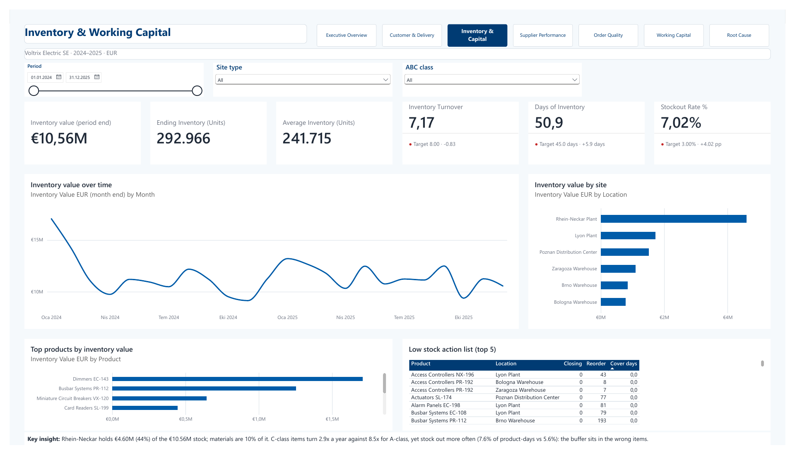
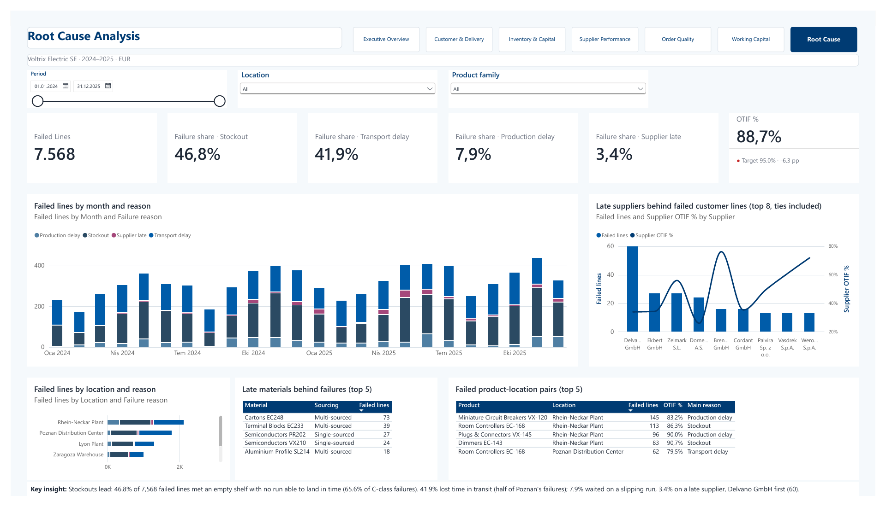

# Voltrix Supply Chain Analytics — Power BI

**An end-to-end supply chain performance report for a fictional European electrical manufacturer: a seeded, validated data pipeline with a bill of materials, a star-schema semantic model with 104 DAX measures, and a 7-page Power BI report (PBIP) that traces every late delivery to its root cause.**

> **Before you open the report:** run `.\setup.ps1` once from the project folder. It points the semantic model's `DataFolder` parameter at your local `data\generated\` folder. Power Query needs this because `File.Contents` requires an absolute path.

## Report preview

Explore the report without installing Power BI: [view all seven pages](docs/screenshots/README.md) or [open the PDF](docs/screenshots/VoltrixSupplyChain.pdf). These are static snapshots of the synthetic dataset for 2024–2025; filters, navigation and drill-through are available in the Power BI project.

### Executive Overview

Service levels, stock and supplier performance, with the sites and suppliers that need attention.



### Inventory & Working Capital

Stock value, turnover and availability, broken down by site and product.



### Root Cause Analysis

Failed deliveries traced to stockouts, transport, production and supplier delays.



The PDF export clips the first card's "OTIF %" label on Executive Overview. Scrollable visuals show only their visible rows; see the [preview notes](docs/screenshots/README.md#preview-notes).

## Headline findings (2024–2025, as of 31 Dec 2025)

- **Service misses target on timing, not completeness.** OTIF is **88.7%** against a 95% target, while In-Full is **97.8%**. **81%** of failed lines arrived complete but late.
- **Stockouts are the largest root cause: replenishment is triggered too late.** Of **7,568** failed lines, **46.8%** met an empty shelf with no production run able to land in time (in 3,516 of the 3,542 a run was on order, but it was raised less than one production lead time before the shelf ran dry), **41.9%** lost time in pick and transit although stock was available, **7.9%** waited on a run that slipped, and **3.4%** waited on material that a supplier delivered late or short. Stockouts hit slow movers hardest: they are **65.6%** of C-class failures, against 35.0% for A-class. *(Before the bill-of-materials pass the classifier counted such lines as production delays, so earlier versions of this report showed almost no stockouts; the shares are not comparable across versions, see [`docs/known-limitations.md`](docs/known-limitations.md#failure-reasons).)*
- **One site drives a disproportionate share.** Poznan DC, the only site serving Poland, runs **84.1%** OTIF and loses half (51.5%) of its failed lines in transit. Polish customers are 17% of due lines but **23%** of late ones, and all 9 of the worst accounts (the 10th place is a tie between a Polish and an Italian customer).
- **Suppliers are unreliable, but the plants absorb most of it.** Supplier OTIF is **56.3%**, and reliability tier predicts it cleanly (A **76.1%** · B **54.2%** · C **34.4%**). Late material reaches the customer in only **257** failed lines (3.4%), though that tripled from 61 in 2024 to 196 in 2025. Delvano GmbH (tier C) is behind 60 of them. Rhein-Neckar receives 56.4% supplier OTIF yet ships **91.0%**, the best of any site, because it holds **44%** of all stock.
- **Single sourcing concentrates the risk.** **11** materials have one supplier. They carry **19.6%** of purchase spend and feed **41** finished goods worth **36.7%** of revenue, and they arrive late 38% of the time against 32% overall.
- **Getting an order "perfect" loses another 4.3 pp.** Perfect Order Rate is **84.4%**: shipment damage runs at **1.81%**, and cross-border paperwork is correct only **94.8%** of the time.
- **Cash is tied up in stock.** The cash-to-cash cycle is **37.9 days** (DSO 39.0 + DIO 50.9 − DPO 52.0). Inventory of **€10.56M** covers 51 days against a 45-day target, and C-class items turn **2.9x** a year versus **8.5x** for A-class (4.6x vs 8.6x counting finished goods only), yet they stock out more often.

## The story in five sentences

Voltrix delivers almost every order in full, but fewer than nine in ten on time, and it misses its 95% OTIF target by 6 points. Tracing every failed line through the inventory ledger and the production orders shows that the biggest single cause is running out of stock with no production run able to arrive in time, followed closely by pick-and-transit time on lines where stock was available. Both concentrate in predictable places: stockouts in slow-moving C-class items whose buffers are sized for average demand, and transit delay at Poznan, the single site serving Poland. Suppliers deliver on time and in full only 56% of the time, but plant stock absorbs most of that, so late material directly causes only 3.4% of failures, although that share is rising and sits with a few tier-C suppliers and 11 single-sourced materials. The levers are therefore replenishment cover for C-class items, dispatch speed at Poznan, and dual-sourcing the single-sourced materials, which together would let safety stock, and with it the 51 days of inventory, come down.

## Architecture

```
scripts/generate  G1 dimensions + bill of materials → G2 demand → G3 sales orders → G4 purchasing (MRP)
                  → G5 fulfilment ledger + production orders → G7 enrichment (status flags)
                  → G8 order quality, failure reasons with supplier/material root cause, invoice/payment dates
scripts/validate  V1–V8: one validator per stage (integrity, grain, identity, plausibility, KPI bands)
                  V9: CSV ↔ semantic-model contract (columns, types, relationship keys)
                  V10: report definition (JSON, field bindings, overlaps, phone layout, insight width)
scripts/kpi_reference.py   regenerates docs/kpi-reference.md from the model and the CSVs
tests/            deterministic business-rule tests on hand-built fixtures
data/generated    14 CSVs (the published dataset) · data/validation: reports, KPI values, SHA-256 manifest
        │
        ▼
VoltrixSupplyChain.SemanticModel   (TMDL)
   Star schema: DimDate · DimCustomer · DimProduct · DimLocation · DimSupplier · DimMaterial
                FactSalesOrderLine · FactShipmentLine · FactPurchaseOrderLine · FactGoodsReceiptLine · FactInventorySnapshot
   BomProductMaterial (finished good → material bridge) · DimTarget (disconnected targets)
   RLS roles (Executive, Regional Manager) · DataFolder parameter
   _KPI Measures: 104 measures — service, quality, failure analysis, backorders, supplier performance,
                  supply risk (BOM), inventory, working capital, targets/status, YoY
        │
        ▼
VoltrixSupplyChain.Report          (PBIR)
   7 analysis pages + drill-through (Customer Detail) + 3 report-page tooltips,
   page navigator, phone layout for every page
```

Every generator is seeded (`20250920`). The validation pipeline can re-run the data build and check that all 14 CSVs are byte-identical to the first run, then write their SHA-256 values to `data/validation/sha256_manifest.txt`. Each post-processing stage (G7, G8) proves that it never changes an existing column: G7 records the hashes of the untouched columns and V8 checks them.

## Key KPI definitions

| KPI | Formula (see `docs/kpi-reference.md` for exact DAX) | Grain | Value |
|---|---|---|---|
| OTIF % | due lines delivered complete by the requested date ÷ due lines | sales order line | 88.7% |
| On-Time Delivery % | due lines whose last delivery ≤ requested date ÷ due lines | sales order line | 89.0% |
| In-Full % | due lines delivered in full ÷ due lines | sales order line | 97.8% |
| Fill Rate % | delivered qty ÷ ordered qty (due lines) | sales order line | 98.7% |
| Perfect Order Rate % | due lines that are OTIF, undamaged and with correct documents ÷ due lines | sales order line | 84.4% |
| Damage Rate % | damaged shipment lines ÷ shipment lines | shipment line | 1.81% |
| Document Accuracy % | shipment lines with correct documents ÷ shipment lines | shipment line | 96.9% |
| Supplier OTIF % | due PO lines received complete by the expected date ÷ due PO lines | PO line | 56.3% |
| Mean Lead Time (Days) | average order-to-receipt days | goods receipt line | 21.1 |
| Inventory Value EUR | closing stock value on the last day of the period | daily snapshot | €10.56M |
| Inventory Turnover | annualised COGS ÷ average inventory value | daily snapshot | 7.17 |
| Days of Inventory (DIO) | 365 ÷ turnover | daily snapshot | 50.9 |
| Stockout Rate % | snapshot rows with zero stock ÷ snapshot rows | daily snapshot | 7.02% |
| DSO / DPO | revenue-/cost-weighted invoice-to-payment days (paid invoices) | invoice line | 39.0 / 52.0 |
| Cash-to-Cash Cycle | DSO + DIO − DPO | — | 37.9 days |
| Single Source Spend Share % | PO spend on materials with one supplier ÷ PO spend | PO line | 19.6% |
| At-Risk Revenue Share % | revenue of finished goods whose BOM contains a single-sourced material ÷ revenue | shipment line | 36.7% |
| Failure Share % | failed lines with a given primary reason ÷ failed lines | failed sales order line | Stockout 46.8 · Transport 41.9 · Production 7.9 · Supplier 3.4 |

## How to run

1. **Set up the local clone.** Open a terminal in the project folder first. On Windows, the easiest way is to open the project folder in File Explorer, right-click an empty area, choose **Open in Terminal**, then run:
   ```powershell
   .\setup.ps1
   ```
   This updates `DataFolder` to your local `data\generated\` path. If Git then shows `VoltrixSupplyChain.SemanticModel/definition/expressions.tmdl` as locally modified, that is expected; it contains your machine-specific path and should not be committed. If PowerShell says it cannot find `setup.ps1`, the terminal is probably open in the wrong folder. If PowerShell blocks local scripts, run `powershell -ExecutionPolicy Bypass -File .\setup.ps1` instead.
2. **Report.** Open `VoltrixSupplyChain.pbip` in Power BI Desktop (built against version 2.157; any recent build with the PBIR and TMDL preview features enabled), then refresh the report.
   In Power BI Desktop edit mode, use **Ctrl + click** on the page-navigation buttons. In reading or published view, a normal click changes the page.
3. **Data.** The CSVs are already included in `data/generated/`, so no separate data-generation step is needed to view the report.
4. **Row-level security.** Go to *Modeling → View as → Other user*, enter `manager.poznan@voltrix.example` and tick **Regional Manager**: every page then shows Poznan only. Tick **Executive** to see everything. The user-to-site mapping lives in the hidden `SecurityUserLocation` table.

## Known limitations

The data is synthetic, and a few design choices were deliberate trade-offs. The main ones:

- `DataFolder` must be an absolute path, so each clone sets it once.
- *Supplier late* is traced counterfactually (would the kit have been complete had the suppliers delivered on time and in full?), and the knock-on test replays replenishment in a simplified twin that agrees with the actual on-time flag on 93.8% of the affected lines.
- DSO is survivorship-biased, since invoices still unpaid at the as-of date are excluded.
- The insight texts describe the full period and do not react to slicers.

Full list, each with the reason it was left: [`docs/known-limitations.md`](docs/known-limitations.md).

## Repository structure

```
VoltrixSupplyChain.pbip              open this in Power BI Desktop
setup.ps1                            one-time local setup: DataFolder path
VoltrixSupplyChain.Report/           report definition (PBIR JSON)
VoltrixSupplyChain.SemanticModel/    semantic model (TMDL)
data/generated/                      the 14 published CSVs
data/validation/                     validation reports, KPI values, SHA-256 manifest
scripts/generate/                    G1–G8 generators
scripts/validate/                    V1–V10 validators
scripts/kpi_reference.py             regenerates docs/kpi-reference.md (all 104 measures, DAX and values)
tests/                               business-rule tests
powerbi/                             measure/target source copies (kpi_measures.tmdl, dim_target.tmdl, builder), theme
docs/                                business scenario, data model, grains, KPI reference, UI design spec, limitations, logs
```

## Repository hygiene

The repository is intended to publish the PBIP source, generated synthetic CSVs, validators and documentation. Local Power BI caches, `.pbix` backup copies and working backups under `powerbi/backup/` are intentionally ignored by Git; keep them locally if they help development, but do not publish them.
