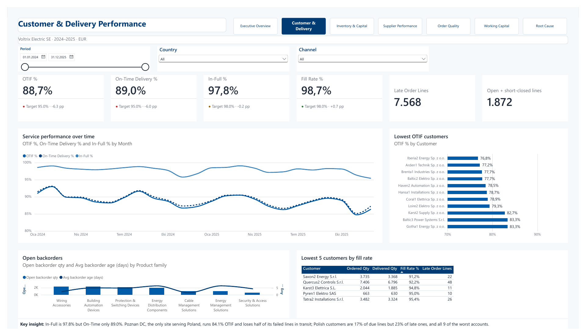
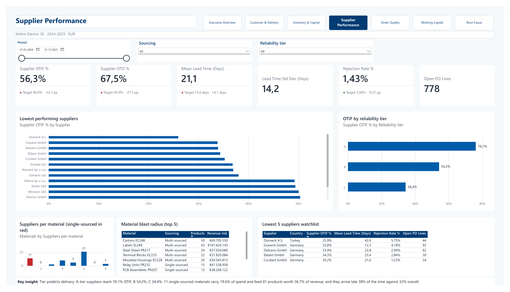
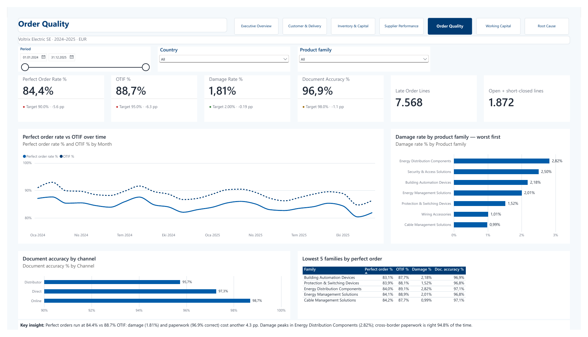
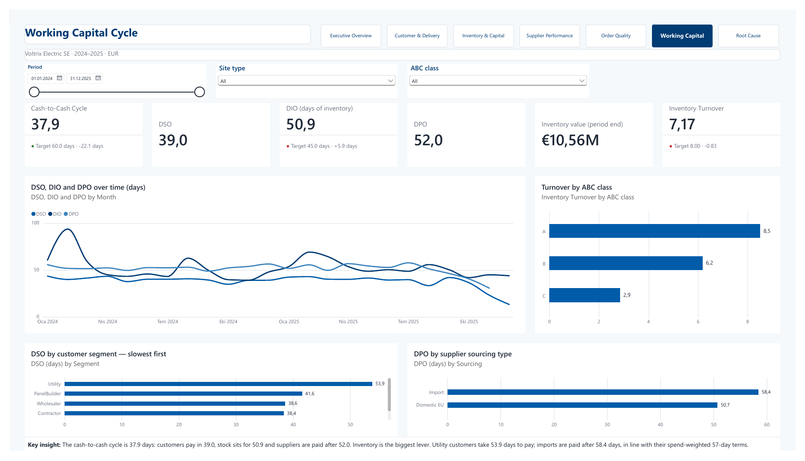

# Report screenshots

Seven analysis pages exported from Power BI Desktop on 28 September 2026. The report uses synthetic data for 2024-2025. Each PNG is rendered from the supplied PDF at 1920 pixels wide, preserving the page proportions.

[Open the complete PDF](VoltrixSupplyChain.pdf) | [Setup and project documentation](../../README.md#how-to-run)

## Executive Overview

## Customer & Delivery

## Inventory & Capital

## Supplier Performance

## Order Quality

## Working Capital

## Root Cause

## Preview notes

- Images and PDF are static: navigation buttons, slicers, tooltips and drill-through do not work here.
- Scrollable charts and tables show only the rows visible at export, not their complete contents. Some top-N tables include ties.
- The first card's "OTIF %" label on Executive Overview is partially clipped in the supplied export; its value is 88.7%.
- Month names and number separators follow the locale used when exporting.
- Customer Detail, report tooltips and phone layouts are not included in this seven-page export.

To update the previews, export the report from Power BI Desktop again and replace the PDF and matching PNGs together. Keep the filenames above so README links remain valid.
